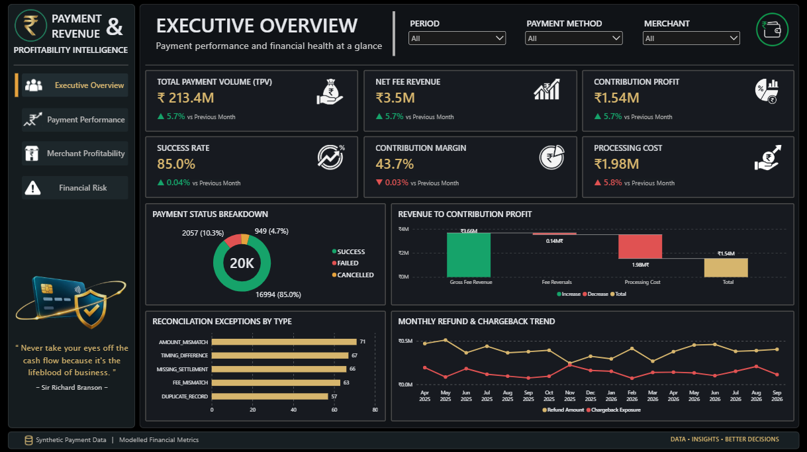
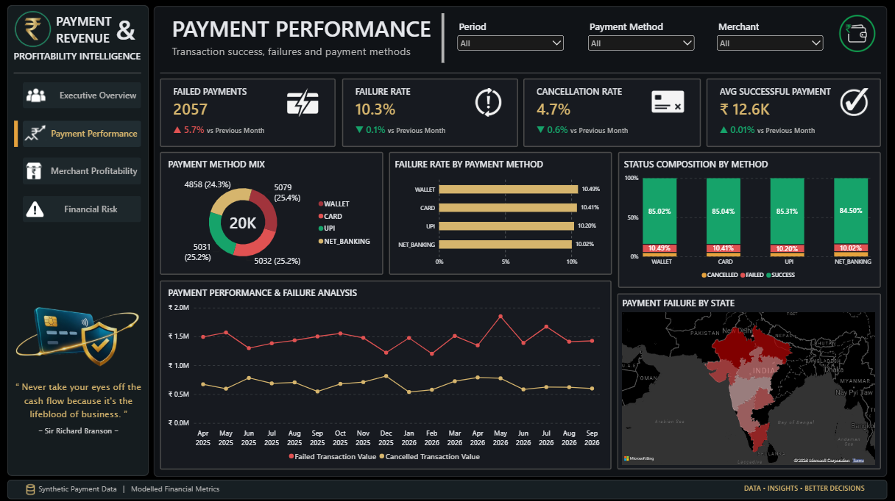
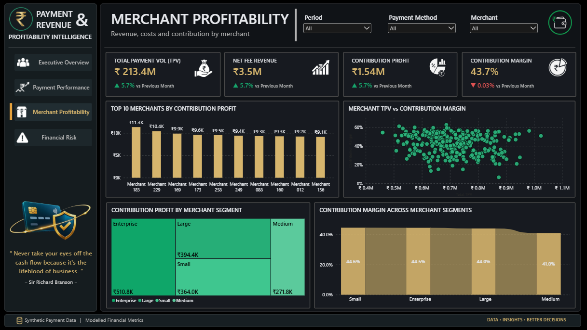
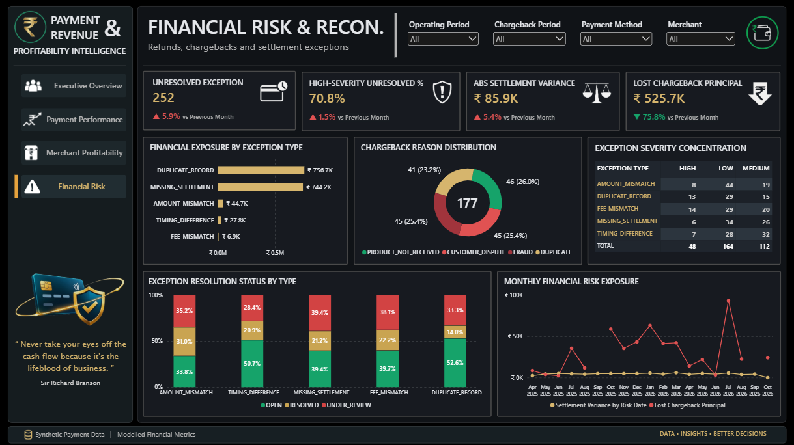

# Payment Revenue & Profitability Intelligence

A financial analytics project built to evaluate payment performance, fee revenue, contribution profitability, merchant performance, and reconciliation risk using synthetic payment data.

**Current status:** Python data pipelines, PostgreSQL analytics, FastAPI endpoints, automated tests, and a four-page Power BI dashboard are completed. The GenAI intelligence layer is the next development phase.

## Dashboard

The final Power BI solution contains four analytical pages.

### 01 — Executive Overview



### 02 — Payment Performance



### 03 — Merchant Profitability



### 04 — Financial Risk & Reconcilation




## Business Problem

Payment businesses need visibility into how transaction outcomes, fee reversals, processing costs, refunds, chargebacks, and settlement discrepancies affect financial performance.

This project addresses four analytical areas:

- **Payment performance:** Success, failure, cancellation, and payment-method performance.
- **Revenue and profitability:** Gross fees, fee reversals, net fee revenue, processing costs, and contribution profit.
- **Merchant profitability:** TPV, contribution profit, contribution margin, and merchant-level comparisons.
- **Financial risk:** Chargebacks, settlement variances, reconciliation exceptions, and unresolved exposure.

## Dataset

The project uses generated, synthetic payment and merchant records.

| Dataset | Records |
|---|---:|
| Payment attempts | 20,000 |
| Merchants | 300 |
| Transaction fees | 16,994 |
| Settlements | 16,175 |
| Refunds | 670 |
| Chargebacks | 177 |
| Reconciliation exceptions | 324 |

The dataset covers an 18-month transaction period and four payment methods: UPI, cards, net banking, and wallets.

## Key Financial Results

Results from the current synthetic dataset:

| Metric | Result |
|---|---:|
| Payment attempts | 20,000 |
| Successful transactions | 16,994 |
| Failed transactions | 2,057 |
| Cancelled transactions | 949 |
| Payment success rate | 84.97% |
| Total payment volume (TPV) | ₹213,374,487.23 |
| Gross fee revenue | ₹3,663,791.42 |
| Fee reversals | ₹140,539.56 |
| Net fee revenue | ₹3,523,251.86 |
| Processing cost | ₹1,982,289.95 |
| Contribution profit | ₹1,540,961.91 |
| Contribution margin | 43.74% |
| Settlements with recorded variance | 1,595 |
| Absolute settlement variance | ₹85,850 |

These figures represent the generated dataset and the project's current analytical assumptions. They are not actual payment-provider or merchant results.

## Financial Metric Definitions

- **TPV:** Sum of successful transaction amounts.
- **Gross fee revenue:** Recorded gross transaction fees before reversals.
- **Net fee revenue:** Gross fee revenue less fee reversals.
- **Contribution profit:** Net fee revenue less modelled processing costs.
- **Contribution margin:** Contribution profit divided by net fee revenue.
- **Settlement variance:** Difference between expected and actual settlement amounts.

Processing costs use illustrative assumptions by payment method, not actual provider pricing.

Settlement expectations currently use successful transaction amounts less gross fees, with an expected settlement date two days after the transaction date. Refunds and chargebacks are analysed separately and are not automatically deducted from this settlement calculation.

Settlement variances and reconciliation exceptions indicate items requiring investigation; they are not automatically confirmed financial losses.

## Power BI Dashboard

The completed dashboard contains four analytical pages.

### 1. Executive Overview
- Total TPV, net fee revenue, contribution profit, processing cost, success rate, and contribution margin.
- Revenue bridge from gross fee revenue to contribution profit.
- Payment status breakdown.
- Reconciliation exception overview.
- Monthly refund and chargeback trends.

### 2. Payment Performance & Failure Analysis
- Failed transaction value and failure rate.
- Cancellation rate and average successful payment.
- Payment method mix.
- Failure rate and status composition by payment method.
- Payment failure distribution by location.
- Monthly failed and cancelled transaction value.

### 3. Merchant Profitability
- Merchant-level TPV, net fee revenue, contribution profit, and contribution margin.
- Top 10 merchants by contribution profit.
- Merchant TPV versus contribution margin.
- Contribution profit by merchant segment.

### 4. Financial Risk & Reconciliation
- Unresolved exceptions.
- High-severity unresolved percentage.
- Absolute settlement variance.
- Lost chargeback principal.
- Financial exposure by exception type.
- Chargeback reason distribution.
- Exception severity concentration.
- Exception resolution status by type.
- Monthly financial risk exposure.

The dashboard uses a shared operating-period filter and a separate chargeback-period filter to distinguish transaction and settlement reporting from actual chargeback-date analysis.

## Technical Architecture

```text
Synthetic Payment Data
        |
        v
Python Data Generation & Loading
        |
        v
PostgreSQL Database
        |
        v
SQL Financial Analytics
        |
        v
FastAPI REST Endpoints
        |
        v
JSON Responses

Power BI
        |
        v
Four-page Financial Analytics Dashboard

Next Development Phase:
FastAPI + Gemini API
        |
        v
Financial Intelligence & GenAI Layer
```

## Technology Stack

| Technology | Purpose |
|---|---|
| Python | Data generation, transformation, validation, and API implementation |
| Pandas | Data processing |
| PostgreSQL | Relational data storage |
| SQL | Financial analytics and data validation |
| FastAPI | REST API development |
| SQLAlchemy + psycopg | Database connectivity and SQL execution |
| Pydantic | Request and response validation |
| pytest | Automated testing |
| Power BI | Financial reporting and interactive dashboards |
| Google Gemini API | Planned LLM-based financial interpretation |

## API Endpoints

| Endpoint | Purpose |
|---|---|
| `GET /health` | API health check |
| `GET /analytics/overview` | Overall payment and financial metrics |
| `GET /analytics/merchant-profitability` | Merchant-level profitability analysis |
| `GET /docs` | Interactive Swagger documentation |

The merchant profitability endpoint supports `limit`, `start_date`, and `end_date` parameters.

Example:

```http
GET /analytics/merchant-profitability?limit=10&start_date=2026-09-01&end_date=2026-09-30
```

Dates use `YYYY-MM-DD` format. The endpoint validates the date range and limit.

## Repository Structure

```text
payment-revenue-profitability-intelligence/
│
├── api/
│   ├── __init__.py
│   ├── analytics.py
│   ├── config.py
│   ├── database.py
│   ├── main.py
│   ├── schemas.py
│   └── transactions.py
│
├── dashboard_imgs/
│   ├── 01_Executive_Overview.png
│   ├── 02_Payment_Performance.png
│   ├── 03_Merchant_Profitability.png
│   └── 04_Financial_Risk.png
│
├── data/
│   ├── chargebacks.csv
│   ├── generate_chargebacks.py
│   ├── generate_data.py
│   ├── generate_exceptions.py
│   ├── generate_refunds.py
│   ├── generate_settlements.py
│   ├── load_data.py
│   ├── merchants.csv
│   ├── reconciliation_exceptions.csv
│   ├── refunds.csv
│   ├── settlements.csv
│   ├── transaction_fees.csv
│   ├── transactions.csv
│   └── update_fee_reversals.py
│
├── powerbi/
│   └── [Power BI dashboard file]
│
├── sql/
│   ├── sql_docs/
│   ├── 01_data_validation.sql
│   ├── 02_financial_analytics.sql
│   └── schema.sql
│
├── tests/
│   ├── test_analytics.py
│   ├── test_api.py
│   ├── test_db_connection.py
│   └── test_transactions.py
│
├── .gitignore
├── README.md
└── requirements.txt
```
Python cache folders and generated test artifacts are omitted from this documentation view.

## Local Setup

### Prerequisites
- Python
- PostgreSQL
- Git

### 1. Clone the repository

```bash
git clone https://github.com/rahuldixit01/payment-revenue-profitability-intelligence.git
cd payment-revenue-profitability-intelligence
```

### 2. Create a virtual environment

```powershell
python -m venv .venv
.\.venv\Scripts\Activate.ps1
```

### 3. Install dependencies

```bash
python -m pip install -r requirements.txt
```

### 4. Configure PostgreSQL

Create a database named `payment_intelligence`.

Configure the database connection using environment variables:

```powershell
$env:DB_USER = "postgres"
$env:DB_HOST = "localhost"
$env:DB_PORT = "5432"
$env:DB_NAME = "payment_intelligence"
```

Set `DB_PASSWORD` securely in your local environment. Never commit database passwords, API keys, or `.env` files.

### 5. Prepare the database

Use the supplied SQL schema and data-loading scripts.

The loader inserts records into the database. Do not rerun it against an already populated database without first preparing a safe reset or reload procedure.

### 6. Start the API

```bash
python -m uvicorn api.main:app --reload
```

Local endpoints:

- Health: `http://127.0.0.1:8000/health`
- Swagger: `http://127.0.0.1:8000/docs`
- Overview: `http://127.0.0.1:8000/analytics/overview`

## Testing and Validation

The latest recorded test run completed with:

- 22 tests passed.
- 100% statement coverage.
- 123 statements measured, with zero missed.

Tests cover database connectivity, analytics results, API responses, transaction validation, date filters, and invalid inputs.

Run:

```bash
python -m pytest
```

Generate a coverage report:

```bash
python -m pytest --cov=api --cov-report=term-missing
```

Coverage measures executed statements; it does not guarantee that every possible scenario is correct.

## Data Limitations

- All generated transaction and merchant records are synthetic.
- Processing-cost assumptions are illustrative.
- Settlement variances and reconciliation exceptions require investigation and do not independently establish realised losses.
- Refunds, chargebacks, and settlement discrepancies are tracked separately from contribution profit.
- Financial results depend on the current dataset and documented metric definitions.

## Development Roadmap

- [x] Generate synthetic payment datasets.
- [x] Build PostgreSQL schema and load data.
- [x] Implement SQL financial analytics.
- [x] Develop FastAPI endpoints.
- [x] Add automated tests and validate API responses.
- [x] Build the four-page Power BI dashboard.
- [ ] Integrate Google Gemini API.
- [ ] Develop the Financial Intelligence & GenAI layer.
- [ ] Generate evidence-grounded root-cause explanations and recommendations.
- [ ] Validate LLM responses against known financial scenarios.
- [ ] Integrate generated insights into a user-facing interface.

## Project Direction

The next development phase extends the existing analytics API with an LLM-based financial interpretation layer.

SQL and Python will remain responsible for calculating and validating financial metrics. Gemini will interpret verified outputs to explain performance movements, identify potential risk drivers, and generate evidence-based business recommendations.

The objective is to combine structured financial analytics with grounded AI-assisted decision support, without treating generated explanations as a substitute for financial validation.